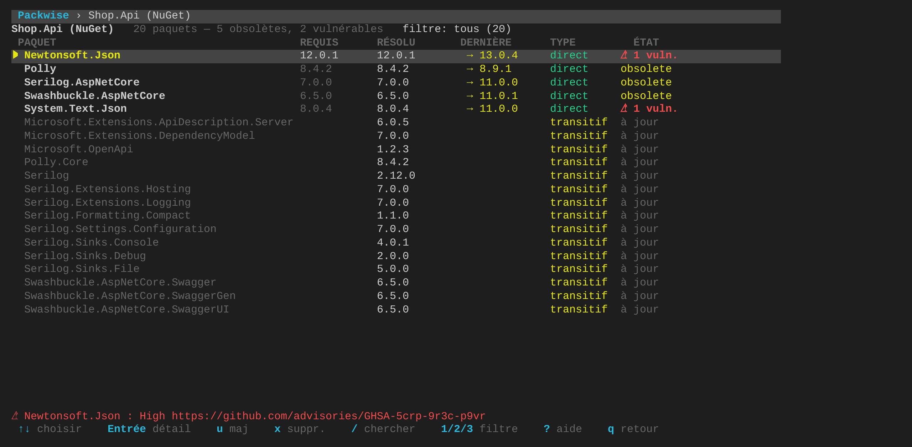
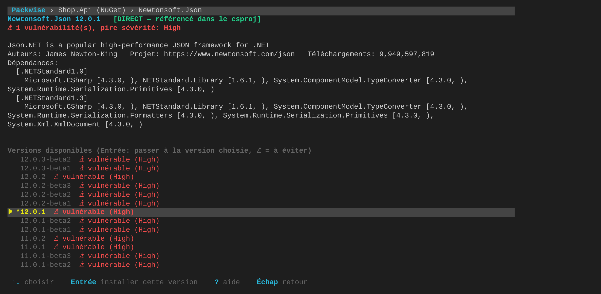
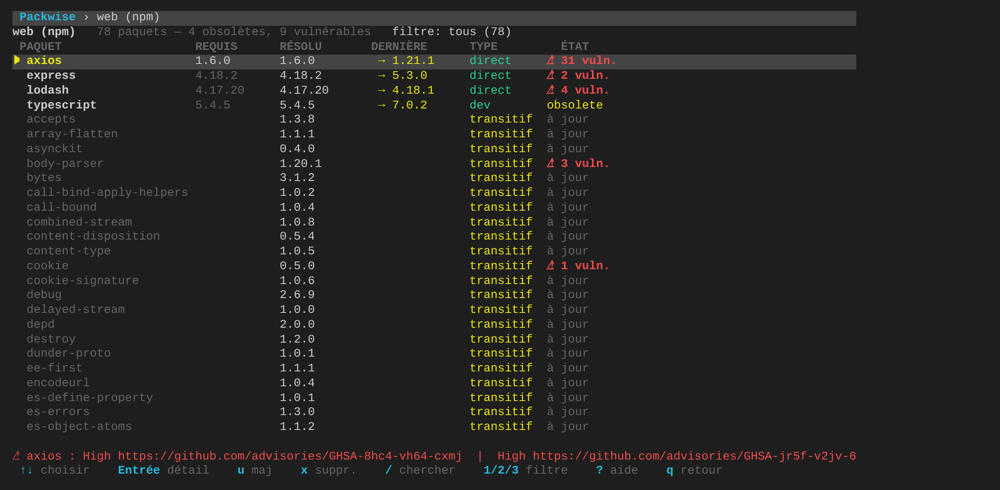

<p align="center"></p>

# Packwise TUI

A small console UI to manage the **NuGet** (.NET) and **npm** (Node.js) dependencies of a project: declared and
resolved versions, latest available version, direct and transitive packages, vulnerabilities, update and removal.

- .NET 10, **no NuGet package** (System.Text.Json only), hand-written ANSI interface
- One provider per ecosystem behind a common interface (`IEcosystem`), like the
  [VS Code extension](https://github.com/tinou0902/packwise)
- NuGet: resolution, outdated and vulnerable packages through `dotnet list package`; versions and metadata through the
  NuGet v3 API (nuget.org)
- npm: tree, outdated and vulnerable packages through `npm ls`, `npm outdated` and `npm audit`; versions and metadata
  through the npm registry (registries from `.npmrc` honoured)







## Requirements

- .NET 10 SDK for NuGet projects (and to run from source)
- Node.js and npm for npm projects
- An ANSI terminal (Windows Terminal, modern PowerShell, etc.)
- Network access for latest versions, vulnerabilities and details (offline, the list is still shown with a warning)

## Install

Each `vX.Y.Z` tag publishes a [release](https://github.com/tinou0902/packwise-tui/releases) with a self-contained
executable (no .NET runtime needed to start the TUI) for Linux (x64, arm64), Windows (x64) and macOS (x64, arm64).
Extract the archive and put `Packwise` (`Packwise.exe`) in your `PATH`.

On macOS the binary is not notarized: run `xattr -d com.apple.quarantine Packwise` if it is blocked on first launch.

To release a version: update `<Version>` in `Packwise.csproj`, then push the matching `vX.Y.Z` tag (the pipeline fails
if they differ).

## Run

```
Packwise [folder]
```

Or from source: `dotnet run -- [folder]`.

Without an argument, the current folder is scanned (4 levels deep; `bin`, `obj`, `node_modules`, hidden folders, the
legacy NuGet `packages` folder and git-ignored files, such as copies of build outputs, are skipped) for `.csproj` and
`package.json` files. The `TYPE` column of the project picker shows the ecosystem.

- **NuGet**: the project is restored once when opened, then its three `dotnet list package` runs (installed, outdated,
  vulnerable) run in parallel without restoring.
- **npm**: each `package.json` is a project, workspace root or member alike; a member is driven from its root with
  `--workspace`. **pnpm** and **Yarn** projects (`packageManager` field or lock file) are **read-only**: declared
  packages, installed versions (`node_modules`) and latest versions, without transitive packages or vulnerabilities.

## Screens and shortcuts

**Project picker**: `↑` `↓` navigate, `Enter` open, `F5` rescan, `q` or `Esc` quit.

**Package list** (columns: package, requested, resolved, latest, type, status)

| Key | Action |
|---|---|
| `↑` `↓` `PgUp` `PgDn` `Home` `End` | navigate |
| `/` | search (projects or packages); `Enter` confirms, `Esc` clears |
| `?` / `F1` | help |
| `Enter` / `d` | package details |
| `u` | update to the latest stable version (with confirmation) |
| `x` | remove, direct packages only (with confirmation) |
| `1` `2` `3` / `t` | filter: all / outdated / vulnerable |
| `F5` | reload |
| `q` / `Esc` | back to the project picker |

The `TYPE` column shows `direct` (declared in the project), `dev` / `optional` / `peer` (npm dependency of that kind)
or `transitif` (transitive: pulled in by another dependency).

**Details**: description, authors, license, dependencies, vulnerabilities and every published version. Versions to
avoid are flagged: `⚠ vulnérable (sévérité)` for a nuget.org advisory, `⚠ dépréciée` for a deprecated npm version.
`↑` `↓` pick a version, `Enter` or `a` to switch to it, `q` / `Esc` to go back.

`Ctrl+C` quits at any time.

The interface itself is in French; the labels above are its own.

## Limitations

- Updating a transitive package adds it as a direct reference (csproj, `dependencies` of package.json).
- NuGet: updating fails with central package management (`Directory.Packages.props`); only nuget.org is queried for
  details (`dotnet list` itself honours your `NuGet.Config`).
- npm: an update installs the exact version and keeps the range prefix (`^`, `~` or exact version); authenticated
  registries are not supported for details; vulnerable versions are not flagged in the details (only the
  vulnerabilities of the installed version, through `npm audit`).
- Python (PyPI) is not supported by the TUI yet (it is by the VS Code extension).

## License

[MIT](LICENSE)
